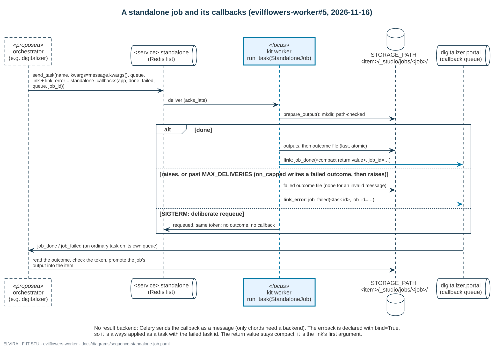
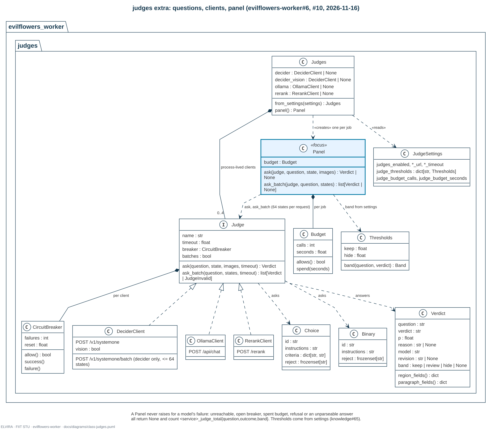
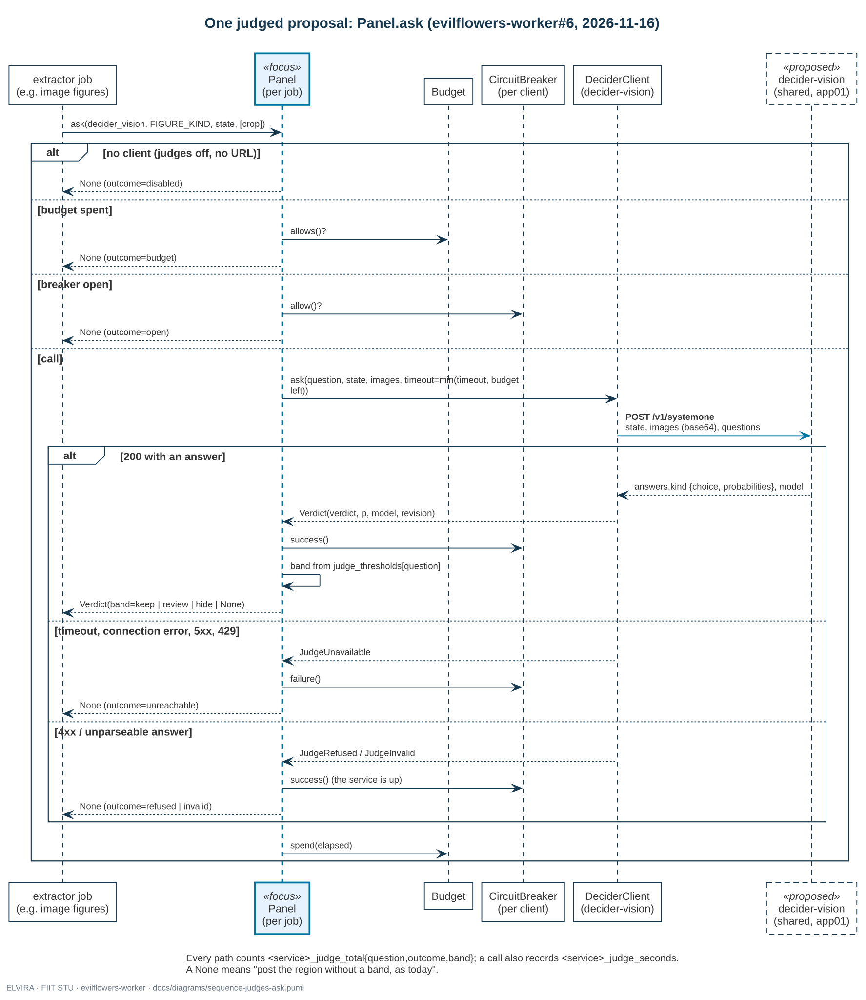

# Extraction workers: architecture and the reference service

Status: **proposed** (2026-11-15). Implemented first by this repository (the kit) and by
[evilflowers-analyzer-service](https://github.com/EvilFlowersCatalog/evilflowers-analyzer-service) (the first service
built on it). The text, image and equation services move to it through the issues listed at the end, and so do the
two catalog-job workers, ocr-service and lcpencrypt-worker (§2, evilflowers-worker#3).

## 1. Why

The four extraction workers were written from one template and then fixed one by one. On `develop` (2026-11-15) they
shared the same concerns and solved each of them differently:

| Concern | analyzer | text | image | equation |
|---|---|---|---|---|
| Reads the run before the work | — (coordinator) | yes | **no** | yes, and every 5 min |
| Sends `?attempt=` | n/a (gets it) | **no** | **no** | yes |
| Reports under a batch `job` name | sends them | **no** | **no** | yes |
| A worker that dies on every try | pass cap (Redis) | `retry_on_worker_lost` + signal | **loops forever** | delivery cap (Redis) |
| SIGTERM during a job | warm + own grace timer | Celery soft shutdown | `REMAP_SIGTERM` | Celery soft shutdown |
| Default visibility timeout | 7200 | 43200 | 7200 | 7200 |
| Catalog client | POST only | GET + POST | POST only | GET + POST + attempt |
| Job protocol | — | ABC | copy, no base | copy, no base |
| Span attribute keys | 6 | 4 | 4 | 5 |

Each of these differences has caused a production incident or would cause one:
- analyzer#3: 24 passes of one book.
- The rollout of 2026-11-14 redid a finished book.
- EvilFlowersCatalog#120: books processed twice.
- EvilFlowersCatalog#140: work done for a superseded attempt.

The observability package was about 600 lines copied four times, and it was already drifting.

Goals:
- **One contract**, written down and validated at both ends.
- **One runtime** with the delivery semantics proven once against a real Redis.
- **One observability package.**
- **A service is its domain code plus about 50 lines of wiring.**

## 2. The model

```
                 ┌───────────── catalog (Django) ─────────────┐
 upload / job ──▶│ ExtractionRun: status, attempt, jobs{…}    │◀── facts: POST /extraction/v1/runs/{id}/…
                 │ system of record, finishes the run          │     (start, regions, paragraphs, jobs/{job})
                 └──────┬──────────────────────────────────────┘
                        │ command: evilflowers_analyzer.extract (Celery, Redis)
                        ▼
                 analyzer  (coordinator)  ── opens the PDF, POST /start → attempt, lays out
                        │ commands, one per job (Celery, Redis), each carrying run_id + attempt (+ job)
          ┌─────────────┼───────────────┬─────────────────┐
          ▼             ▼               ▼                 ▼
   text.paragraphs  text.tables   image.figures   equation.equations   (leaf jobs)
```

**Roles**
- **Catalog: system of record.** It owns the run's state machine (`queued → running → done | failed`) and its
  `attempt`, and it finishes a run when every declared job has reported. Workers never write to its database and
  hold no state of their own beyond a delivery counter.
- **Coordinator (the analyzer).** It turns one `extract` command into a declared set of jobs: `/start` with their
  names returns the attempt, and then it sends one command per job. It reports only its own failure, as job
  `analyzer`.
- **Leaf job (text, image, equation).** It does one job for one attempt. Its results and its terminal report go to
  the catalog over HTTP.

**Three kinds of worker**
- **Extraction jobs** (the roles above) stream many facts into one run: regions and paragraphs in batches of ≤ 100,
  the catalog capping a request at 5000 regions / 1000 paragraphs, and a terminal report per job. They read the run
  before the work and fence stale writers with `attempt`. HTTP suits that: many writes, each one answered (`409` →
  stop).
- **Catalog jobs** (the IP-031 job-ledger kinds: `files.ocr`, later others) have no extraction run and no attempt.
  Each produces **one terminal outcome**, so it writes that outcome as a file next to its output, and the catalog
  applies it on the Celery `task-succeeded` / `task-failed` event, or on its reconcile tick if the event was lost
  (EvilFlowersCatalog#169, §3.4). The worker then needs no catalog URL, no API key and no HTTP retry logic.

- **Standalone jobs** (evilflowers-worker#5) run without the catalog. The books digitalizer runs the extractors (ocr,
  analyzer, equation, image) and its own scan and render services this way; its orchestrator is the system of record,
  and any other orchestrator could be. Each job is a `contract.StandaloneJob`: `run_id`, `job`, `token`, `inputs`,
  `output_dir` and `outcome`, plus the service's own options in a subclass. The worker reads its inputs and writes into
  a **job-scoped** output directory (`<item>/_studio/jobs/<job>/`, through `prepare_output()` / `output_file()`, which
  check every path against `STORAGE_PATH`). It writes the outcome file last (§3.4), returns a compact summary, and
  holds no database or catalog credential. It runs through `runtime.run_task`, the same as a catalog job.

  The orchestrator learns that the job ended from **Celery callbacks**, not from events or a result backend:

  

  - It sends `send_task(name, kwargs=message.kwargs(), queue=…, **runtime.standalone_callbacks(app, done=…,
    failed=…, queue=…, job_id=…))`.
  - On success Celery sends `done(<return value>, job_id=…)` to the orchestrator's queue, so the return value stays
    compact.
  - On a raised task, Celery sends `failed(<task id>, job_id=…)`. That covers `on_capped` past the delivery cap, and an
    invalid message, which arrives with no outcome file. This single-argument form is the one the Celery docs
    prescribe for tasks sent by name. Declare the errback with `bind=True`: an errback with more than one positional
    parameter that is registered in the failing app is called directly as `(request, exc, traceback)` instead.
  - Neither fires on a deliberate requeue (SIGTERM).

  Callbacks are ordinary messages, so **no result backend** is needed (only chords need one).
  `tests/test_runtime.py` shows these cases against a real Redis. The probe on evilflowers-worker#5 adds two more:
  neither fires on a `retry`, and a worker killed mid-task fires one later, on the redelivery's outcome.

  What the orchestrator must allow for:
  - **Same Redis db.** The worker sends the callback on its own broker, so the callback queue must live on the job's
    Redis db.
  - **At least once.** Celery sends `link` from the task before the late acknowledgement (`celery.app.trace`), so a
    worker that dies in between sends it again on the redelivery. `job_done` and `job_failed` must be idempotent.
  - **`job_failed` without an outcome** means the message was invalid (or the worker raised before writing anything):
    fail the job, never re-send it unchanged.

  The orchestrator then reads the outcome file, checks the token, and promotes the job's output into the item. A
  reconcile tick of its own covers a lost callback.

All three share everything below the domain: the runtime, the delivery cap, the shutdown and the observability.

**Two directions**
- **Commands flow over the broker.** Celery messages are *work orders* (`extract`, `figures`, `paragraphs`, `ocr`, …)
  addressed to one queue, delivered at least once.
- **Facts flow back to the system of record** over one of three channels, by kind of worker:
  - extraction jobs: HTTP to the catalog's ingestion API (§3.2);
  - catalog jobs: an outcome file on the shared storage, applied on the task's Celery event (§3.4);
  - standalone jobs: an outcome file, which the orchestrator reads when its `link` / `link_error` callback arrives.

  There is no reply queue of the workers' own, and no service listens to another service. A standalone job's
  callbacks are messages that Celery itself sends to the orchestrator's queue.

This is choreography around a shared state store. It keeps the catalog the only place that decides whether a run is
done, and it lets every worker scale on its own queue (KEDA, knowledge#43).

**Why not Kafka (now)**
- Nothing runs it (knowledge: the `kafka` profile is off, and the analyzer left Kafka on 2026-11-03).
- Every message here is a command with exactly one consumer.
- Replay and fan-in, Kafka's strengths, are covered by the catalog's run state and the stale sweep.

The seam is kept anyway: messages are pydantic models with a stable task name, and `Publisher` is a protocol. A Kafka
transport would be:
- a `Publisher` that sends `message.kwargs()` to topic = queue, key = `run_id`, with `traceparent` as a header;
- a consumer loop that validates the same model and calls the same job.

## 3. The contract

### 3.1 Messages (commands)

All messages are Celery tasks with **keyword arguments only** and a JSON body.

| Task | Queue | Producer → consumer | Model (`evilflowers_worker.contract`) |
|---|---|---|---|
| `evilflowers_analyzer.extract` | `evilflowers_analyzer` | catalog → analyzer | `ExtractRequest` |
| `evilflowers_text_worker.paragraphs` | `evilflowers.text.paragraphs` | analyzer → text | `ParagraphsJob` |
| `evilflowers_text_worker.tables` | `evilflowers.text.tables` | analyzer → text | `RegionsJob` |
| `evilflowers_image.figures` | `evilflowers_image` | analyzer → image | `RegionsJob` |
| `evilflowers_equation.equations` | `evilflowers_equation` | analyzer → equation | `RegionsJob` |

Rules:
1. **Additive only.** A new field is optional, and consumers ignore what they do not know (`extra="ignore"` /
   `**_`). Removing or retyping a field is a new task name.
2. **`None` is not sent.** Empty lists are sent: `regions: []` means "no regions, report anyway".
3. **Every extraction job message carries `run_id`, `source`, `output_dir`, and `attempt` once the run has one.** A
   standalone job carries `run_id`, `job`, `token`, `inputs`, `output_dir` and `outcome` instead (`StandaloneJob`, §2).
4. **A step re-run** (EvilFlowersCatalog#183): `ExtractRequest.steps` is the sorted subset of `contract.Step`
   (`equations`, `figures`, `paragraphs`, `tables`) to redo; absent or empty is a full pass. The analyzer echoes it in
   `StartRun.steps`, which a full pass leaves out. A 409 `steps_refused` is a `RunNotRunning`: drop the pass.
5. **A batch job carries `job`:** `<kind>:<first>-<last>`, zero-padded, at most 30 characters (the catalog's limit).
6. **Commands are sent from inside the consuming task**, so Celery stamps `parent_id`/`root_id` (the catalog's job
   ledger attributes child tasks by `parent_id`) and the OTel instrumentation injects `traceparent`.
7. **Validation happens at the edge.** A consumer validates its message first. An invalid message is reported as a
   failed job (when `run_id` can be read) and acknowledged; it is never retried.

### 3.2 Facts (catalog ingestion API)

This is the catalog's `/extraction/v1` API, documented in its OpenAPI spec (`evilflowers-protocol`).
`evilflowers_worker.catalog.CatalogClient` is the one client:

| Call | When |
|---|---|
| `GET runs/{id}` → `RunState` | a leaf job, before the expensive part, and between batches |
| `POST runs/{id}/start` → `RunState` (new `attempt`) | the coordinator, once per pass |
| `POST runs/{id}/regions?attempt=` | figures / tables / equations, in batches of ≤ 100 (catalog cap 5000) |
| `POST runs/{id}/paragraphs?attempt=` | paragraphs, batches of ≤ 100 (cap 1000), links on the last batch |
| `POST runs/{id}/jobs/{job}?attempt=` | the terminal report: `done`, `failed` or `superseded` |

Behaviour:
- **Errors.** A 409 is read by the problem's `reason`:
  - `superseded` → `RunSuperseded`: stop, report `superseded`;
  - `not_running` or none → `RunNotRunning`: drop quietly;
  - `duplicate` → `DuplicateResults`: report the job `failed`, because the run still waits for it.

  Other 4xx are not retried and raise `CatalogRefused` (an `HTTPError`), as does a 5xx on the last try. Its message
  carries the call, run, attempt, batch (`batch 2/12, seq 100-199`), status and the catalog's response body, capped at
  1500 characters. That one line is logged at ERROR and becomes the job's reported `error`, so a 422 says which field
  was refused in Loki and in `extraction_run.error` (evilflowers-worker#4). The request payload is never logged.
  Connection errors and 5xx are retried with exponential backoff and counted in
  `<service>_catalog_retries_total{route,reason}`.

### 3.3 Delivery semantics

At-least-once, made safe by idempotency on the catalog's side:

| Situation | What happens | Mechanism |
|---|---|---|
| Worker dies mid-job (OOM) | message redelivered | `acks_late` + `reject_on_worker_lost` |
| Dies on every try | given up after `MAX_DELIVERIES`: an extraction job reports `failed`; a catalog job writes a `failed` outcome file and raises | `DeliveryCounter` (Redis, per task id; a fresh delivery resets it); `LeafJob` / `run_task(on_capped=…)` |
| Scale-in mid-job | finishes within `WORKER_SOFT_SHUTDOWN_TIMEOUT`, else requeued at once | `shutdown` (warm + grace timer + fallback requeue) |
| Run restarted meanwhile | leftover work refused, job stops early | `attempt` + `GET runs/{id}` (`superseded`) |
| Copy of a job already reported | does nothing | `RunState.skip_reason` (`already_done`) |
| Message stuck unacked | restored after `BROKER_VISIBILITY_TIMEOUT` | **one value for every consumer of a Redis db: 12 h** |

The last row is a rule, not a default: kombu restores *every* unacked message older than the restoring consumer's own
timeout, in any queue (EvilFlowersCatalog#120, text#9, lcpencrypt#6).

**Producers must not set `priority` on messages for kit queues, and every app on a Redis db uses the same transport
options.** With priority emulation (`queue_order_strategy: priority`, `priority_steps: range(10)`), a message sent
with `priority=5` goes to the list `<queue>\x06\x165`. A kit worker polls only kombu's default steps (0/3/6/9), so it
never reads that list: the message is stranded (shown on 2026-11-16, evilflowers-worker#5). KEDA and redis_exporter,
which read the plain `<queue>` list, don't see it either. Interactive work gets queues of its own
(`<service>.standalone.interactive`), not a priority.

### 3.4 Outcome files (catalog jobs and standalone jobs)

The pattern is not catalog-specific. For a catalog job the contract belongs to the catalog (EvilFlowersCatalog#169).
For a standalone job it belongs to the orchestrator that sent the job; for the digitalizer that is
evilflowers-books-digitalizer `docs/design/target-architecture.md` §2. `evilflowers_worker.outcome` is the worker's
half either way, and the rules below hold for both. A standalone job's outputs go to its job-scoped `output_dir`, which
the orchestrator promotes only after it has checked the outcome's token. Outputs of a superseded or failed job are
never promoted.

- **Where.** The task's `outcome` kwarg: a path relative to the storage root, next to the output
  (`catalogs/<catalog>/<entry>/ocr/<run_id>.json`). It is checked like every path a worker writes
  (`RuntimeSettings.storage_file`): it must not escape the storage.
- **What.** A JSON object with `run_id`, `token` and `status`, plus the kind's own fields (`OutcomeFile`, which a
  service subclasses). Every field is written, `null` included; a field outside the contract fails in the worker.
- **Last and atomic.** The output first, then the outcome file, which is the commit marker (`write_outcome`:
  `.partial`, fsync, rename, fsync the directory). A crash between the two leaves no outcome, and the catalog ends the
  run `lost`, never applied.
- **Every status,** `failed` included: write the file, then raise, so the job keeps the domain error and the
  traceback. Past the delivery cap too.
- **Never on a deliberate requeue** (SIGTERM, the cold cancel). The redelivery carries the same `token` and writes the
  outcome then. A `failed` file written on the way out would consume the token, and the catalog would refuse the
  redelivery's outcome.
- **The token** is minted by the catalog per run (`CapabilityTokenService`, single use) and echoed back untouched. It
  binds the file to the run the catalog dispatched; it is not a credential of the worker.
- **The task's return value** stays compact (`status`, a few counts): the Celery event carries a `repr` capped at 1024
  characters, so the full outcome lives in the file.

## 4. Observability contract

All of it lives in `evilflowers_worker.observability`, configured by service name. It follows the cluster contract in
knowledge `Cookbooks/Deploy-a-Service` §3.

- **Resource:** `service.name` (`OTEL_SERVICE_NAME`), `service.namespace=elvira`, `service.version=IMAGE_TAG`,
  `service.instance.id`. k8s attributes come from Alloy.
- **Traces:**
  - a CONSUMER span per task, continuing the producer's `traceparent`;
  - PRODUCER spans per command sent;
  - CLIENT spans per catalog call;
  - hand-made spans `<service>.<area>[.<step>]`.
- **Canonical attributes:** they are set by `bind()`, on the span and on every log line.

  | Log field | Span attribute |
  |---|---|
  | `run_id` | `evilflowers.extraction.run_id` |
  | `job` | `evilflowers.extraction.job` |
  | `attempt` | `evilflowers.extraction.attempt` |
  | `pipeline_version` | `evilflowers.extraction.pipeline_version` |
  | `delivery` | `evilflowers.extraction.delivery` |
  | `extract_pass` | `evilflowers.extraction.pass` (analyzer, kept for its dashboards) |
  | `acquisition_id` | `evilflowers.acquisition_id` |
  | `entry_id` | `evilflowers.entry_id` |
  | `source` | `evilflowers.source` |
  | `task_id` | `messaging.message.id` |

  A service extends or overrides this map with `create_app(..., attributes=...)`. A catalog job passes
  `observability.CATALOG_JOB_ATTRIBUTES`: its `run_id` is a run of the job ledger (`evilflowers.run.id`), not an
  extraction run, `job_id` is the ledger's job (`evilflowers.job.id`) and `delivery` becomes
  `evilflowers.job.delivery`. The log fields keep their short names
  either way, so a Loki query for `run_id` finds every service.
- **Standard metrics:** every service gets these from the kit; service-specific ones sit next to them under the same
  prefix.
  - `<service>_task_duration_seconds{celery_task_name,celery_task_state}`
  - `<service>_job_outcome_total{job,outcome}`. Here `job` is the kind, never a batch name. Outcomes are the
    `jobs.Outcome` values for an extraction job, and the outcome file's `status` for a catalog job (`done`, `skipped`,
    `failed`).
  - `<service>_catalog_retries_total{route,reason}`
  - `<service>_deliveries_capped_total`
  - with the `judges` extra (§5.1): `<service>_judge_total{question,outcome,band}` and
    `<service>_judge_seconds{question,outcome}`
- **Logs:** one JSON object per line on stdout, carrying `time`, `level`, `logger`, `message`, `trace_id`, `span_id`,
  `task_name`, `task_id`, the bound fields and `exception`.
- **Profiles:** the Pyroscope SDK when `PYROSCOPE_SERVER_ADDRESS` is set, with `gil_only=False`, and spans linked to
  profiles.
- **Everything is off** without `OTEL_EXPORTER_OTLP_ENDPOINT` / `HOST_IP`, so Compose and tests need nothing.

## 5. The kit

```
src/evilflowers_worker/
├── settings.py        RuntimeSettings: broker, storage (storage_file), shutdown, delivery cap, logs;
│                      WorkerSettings = RuntimeSettings + the catalog ingestion API (services subclass one of them)
├── contract.py        message models (incl. StandaloneJob) + catalog payload models (Box, LayoutRegion, Region, …)
├── catalog.py         CatalogClient for /extraction/v1, RunNotRunning / RunSuperseded / DuplicateResults / CatalogRefused
├── http.py            requests session (User-Agent, bearer key)
├── deliveries.py      DeliveryCounter (Redis): count, cap, forget on a deliberate requeue
├── jobs.py            LeafJob: check → extract → publish → report, outcomes, invalid-message report
├── outcome.py         OutcomeFile, atomic_write, write_outcome: a catalog job's outcome file (§3.4)
├── runtime.py         create_app(), run_job() (leaf jobs), run_task() (anything else): Celery config, queues,
│                      telemetry, shutdown; Publisher; standalone_callbacks() (link / link_error)
├── shutdown.py        SIGTERM: warm shutdown, grace timer, cold cancel, fallback requeue
├── testing.py         FakeCatalog, RecordingPublisher, StubCatalogServer, assert_outcome, WorkerProcess
├── observability/     otel setup, spans, metrics (Instrument), JSON logs, bind(), Pyroscope, Celery signals
└── judges/            the `judges` extra (§5.1): questions, verdicts, bands; HTTP clients of decider,
                       decider-vision, Ollama and tei-rerank; per-job Panel with budget and circuit breakers
```

It has no docling, torch or model dependency. A service pins it to a commit:

```toml
[tool.uv.sources]
evilflowers-worker = { git = "https://github.com/EvilFlowersCatalog/evilflowers-worker", rev = "<sha>" }
```

A fix here reaches a service when it bumps `rev` (and runs `uv lock`); nothing changes under a service that does not.

### 5.1 Judges (the `judges` extra)

Extractors *propose* (regions, OCR lines, captions, formulas). A **judge** answers one narrow question about an
uncertain proposal: is it real, is it an error, is it associated. The answer is stored as provenance. A judge never
edits, and it never fails the job. The checks run inside the extractor that made the proposal, so the catalog tasks
and the standalone tasks ask the same questions (evilflowers-books-digitalizer `docs/design/target-architecture.md` §6,
evilflowers-worker#6).



- **HTTP only.** The kit gains no model or imaging dependency, and the caller passes images already encoded. The extra
  adds no package (it runs on the core's `requests`); a service lists it to declare that it asks judges.
- **Clients** (`DeciderClient`, `OllamaClient`, `RerankClient`) live as long as the process, each with its own circuit
  breaker. `decider` (Laya) takes text only, so the client refuses images before sending; it always sends
  `"model": "multilingual"`. `decider-vision` takes at most 4 images.
- **Questions:**
  - `Choice` (a category, with its probability);
  - `Binary` (yes/no; sent to the decider services as `noul`).

  `reject` names the answers that mean "drop it".
- **`Verdict{question, verdict, p, reason, model, revision, band}`**: `verdict.provenance()` goes into the region's or
  the line's `provenance`; `model_ref` (`model@revision`) is what the catalog stores as `decider_model`.
- **Bands** come from `JUDGE_THRESHOLDS` (per question id, measured in knowledge#65):
  - a rejecting answer with `p ≥ hide` → `hide`;
  - a keeping answer with `p ≥ keep` → `keep`;
  - anything else → `review` (`disputed` in the digitalizer).

  A question without thresholds gets no band. Ollama's `p` is a self-report and tei-rerank's a relevance score:
  neither is calibrated, so band them only with thresholds measured for them.
- **One `Panel` per job** (`Judges.panel()`) holds the job's budget: `JUDGE_BUDGET_CALLS` and `JUDGE_BUDGET_SECONDS`, so
  a book never monopolises app01. A call never waits longer than the seconds left.
- **Pass-through.** `Panel.ask()` returns `None` instead of raising for each of these outcomes, and counts it in
  `<service>_judge_total{outcome}`:

  | Outcome | Cause | Breaker |
  |---|---|---|
  | `disabled` | judges off, or no URL for that model | — |
  | `budget` | the job's budget is spent | — |
  | `open` | the client's breaker is open | — |
  | `unreachable` | timeout, connection error, 429 or 5xx | counts a failure |
  | `refused` | any other non-2xx | closes it |
  | `invalid` | the answer could not be parsed | closes it |

  A caller's bug (images sent to `decider`) still raises `ValueError`.



Settings: the `JudgeSettings` mixin, `class Settings(WorkerSettings, JudgeSettings)`. It reads the variables the cluster
already sets for the image and text-tables workers (`DECIDER_ENABLED`, `DECIDER_VISION_URL`, `DECIDER_TIMEOUT`), plus
`DECIDER_URL`, `OLLAMA_URL`, `RERANK_URL` / `RERANK_API_KEY`, the `*_REVISION`s, `JUDGE_THRESHOLDS`, `JUDGE_BUDGET_*`
and `JUDGE_BREAKER_*`.

### A new service, step by step

1. `settings.py`: `class Settings(WorkerSettings)` with the domain's own fields.
2. `jobs.py`: `class FiguresJob(LeafJob[RegionsJob, list[Region]])` with `kind = "figures"`, `extract()` and
   `publish()`.
3. `worker.py`: `app = runtime.create_app("image", settings, include=[...], queues=[settings.queue])`.
4. `tasks.py`: `@shared_task(name=..., bind=True, **runtime.JOB_TASK_OPTIONS)` whose body is
   `return runtime.run_job(self, FiguresJob, RegionsJob, kwargs)`. That validates the message (an invalid one is
   reported failed by `jobs.report_invalid_message`), counts the delivery and runs the job. The module imports the one
   that calls `create_app`: a pool child started by spawn imports only the tasks module.
5. Tests: the job against `testing.FakeCatalog`; the real worker through `testing.WorkerProcess` against Redis and
   `testing.StubCatalogServer` (`tests/test_runtime.py` here, the analyzer's `tests/test_end_to_end.py` for a whole
   run).

### A catalog job, step by step

1. `settings.py`: `class Settings(RuntimeSettings)`. No `catalog_*` field: the worker holds no catalog credential.
2. `outcome`: `class OcrOutcome(OutcomeFile)` with the kind's fields and `status: Literal["done", "skipped",
   "failed"]`.
3. `worker.py`: `app = runtime.create_app("ocr", settings, include=[...], queues=[settings.queue],
   routes={"evilflowers_ocr_worker.*": settings.queue}, attributes=observability.CATALOG_JOB_ATTRIBUTES)`. The task
   names are a contract with the catalog, so the routes follow them.
4. `tasks.py`: `@shared_task(name=..., bind=True, time_limit=..., **runtime.JOB_TASK_OPTIONS)` whose body is
   `return runtime.run_task(self, jobs.run, OcrRequest, kwargs, on_capped=jobs.give_up)`.
   - `jobs.run(message, delivery)` writes the output, then `write_outcome(...)`, and returns a compact dict;
   - `jobs.give_up(message, delivery)` writes a `failed` outcome and raises;
   - an invalid message raises by default (`on_invalid`): without `outcome`/`token` there is nowhere to write.
5. Tests: `testing.assert_outcome` (fields, token, written after the output); the real worker through
   `testing.WorkerProcess` for the cap and for a scale-in that leaves no outcome (`tests/test_runtime.py`, `probe.convert`;
   `tests/example.py` is the reference).

## 6. Roadmap

| Step | Where |
|---|---|
| Kit | this repository (`master`; catalog jobs since `c37d860`, evilflowers-worker#3) |
| The catalog's 4xx body in the job's error and the log | evilflowers-worker#4 |
| Analyzer on the kit | evilflowers-analyzer-service (pinned to `ae8e238`) |
| text, image, equation adopt the kit | text-service#16, #17 (+ #15 `outline`), image-service#5, equation-service#7 |
| Housekeeping: README, tooling, CI with Redis | evilflowers-worker#1 |
| `reason` on every 409 (`duplicate`); refuse undeclared job names; `//` in the OpenAPI paths | EvilFlowersCatalog#180 |
| Task messages as AsyncAPI next to the OpenAPI spec | evilflowers-protocol#1 |
| Telemetry, settings and manifest changes; worker liveness without a port; the denied kill on `control` | knowledge#56 |
| Analyzer OOM at 6Gi | knowledge#55 |
| Catalog jobs on the kit: outcome files, `RuntimeSettings`, `run_task`, attributes, Python 3.14 | evilflowers-worker#3 |
| The `files.ocr` outcome-file contract (catalog side, worker side) | EvilFlowersCatalog#169, ocr-service#5 |
| ocr-service and lcpencrypt-worker adopt the kit | ocr-service#6, lcpencrypt-worker#8 |
| `judges` extra: shared clients and question schemas (§5.1) | evilflowers-worker#6 |
| Thresholds and latency of decider / decider-vision | knowledge#65 |
| image-service's decider call on the extra | image-service#6 |
| Standalone jobs: `StandaloneJob`, `standalone_callbacks`, link / link_error without a result backend | evilflowers-worker#5 |
| `Region` decision fields (`band`, `p`, `score`, `decision`, `decider_model`, `review_outcome`, `grounded_share`, `signals`) | evilflowers-worker#7, EvilFlowersCatalog#189 |

## 7. Open questions

- **A static catalog key for extraction?** EvilFlowersCatalog#169 sets a rule for catalog jobs: a worker that ever
  needs an HTTP callback authenticates with its run's capability token, never with a static service API key. Every
  extraction worker still holds a static `CATALOG_API_KEY` (`extraction.ingest_extraction`). Either the rule is
  scoped to job-ledger kinds, because extraction writes many times per run and `attempt` already fences stale
  writers, or the catalog mints a per-run token into `ExtractRequest` (forwarded by the analyzer in every job
  message) and the key goes away. That is a catalog decision first, then a change here (`JobMessage`,
  `CatalogClient`).
- **One spelling for the acquisition attribute.** The kit has `evilflowers.acquisition_id`, ocr-service
  `evilflowers.acquisition.id`. Settle it with the dashboards (knowledge#56) before ocr-service adopts the kit.
